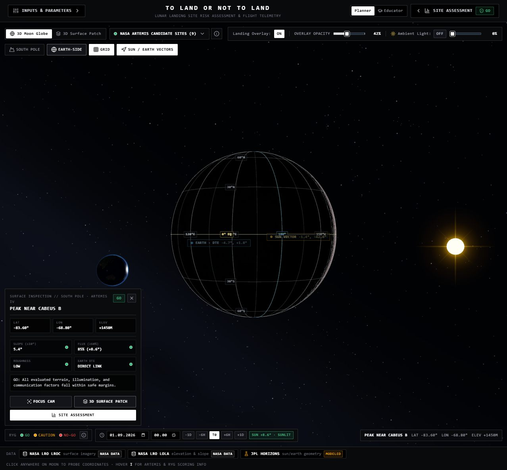
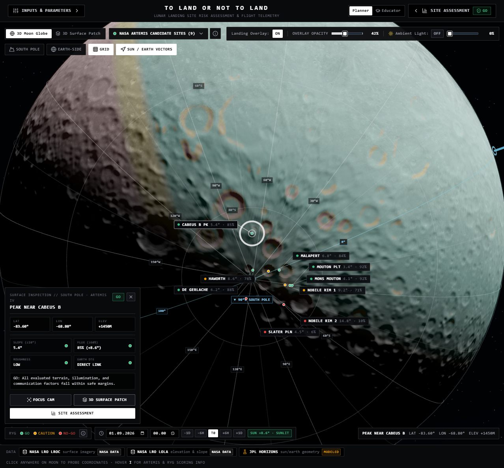
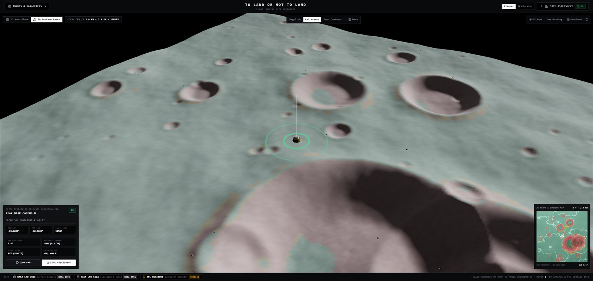
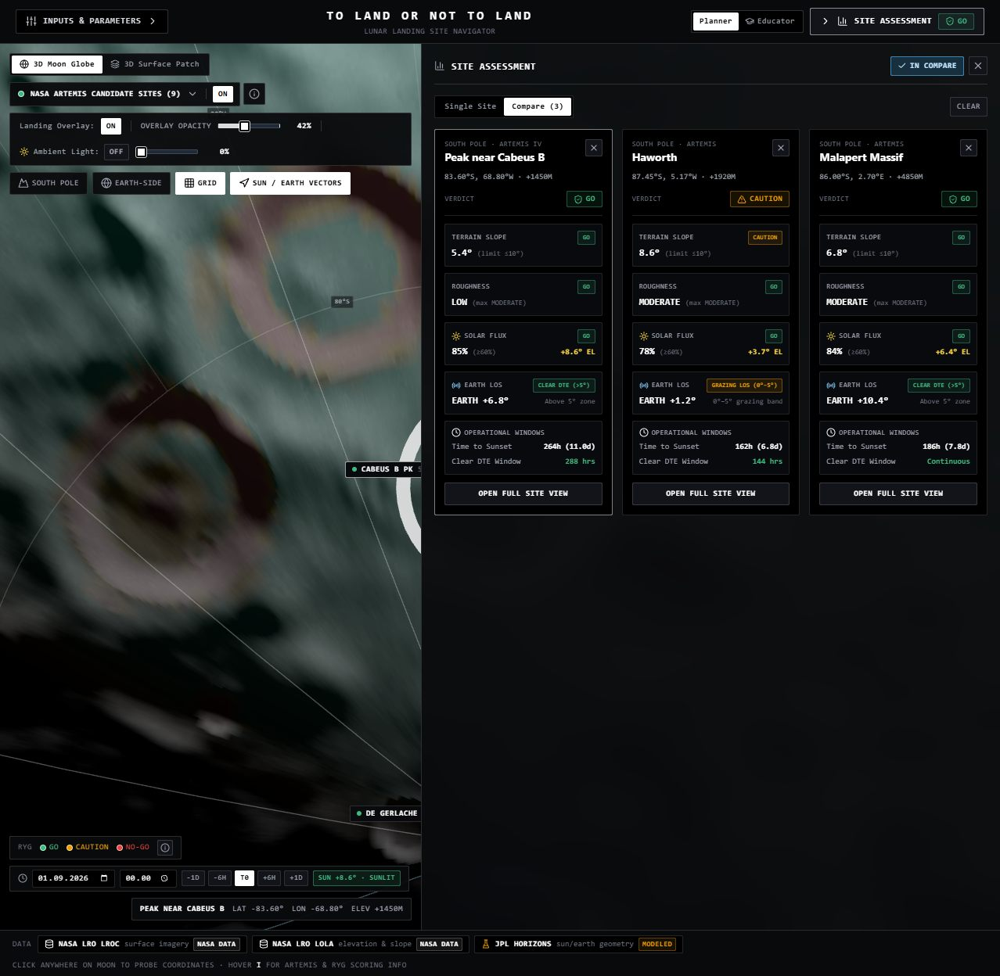
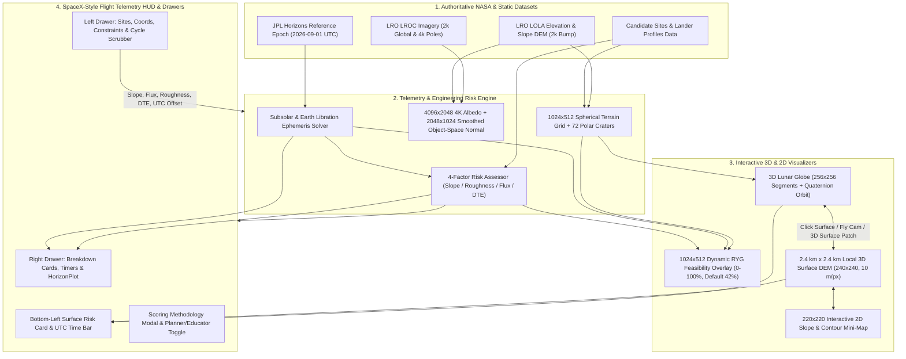
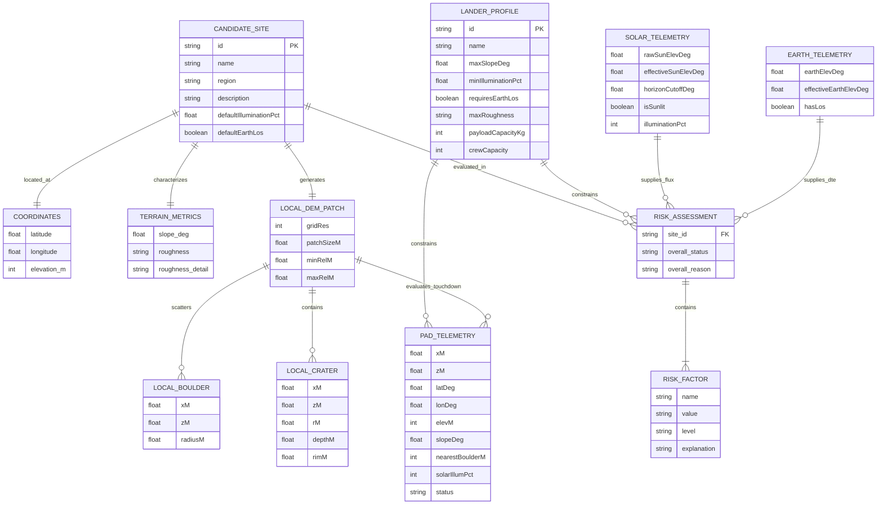
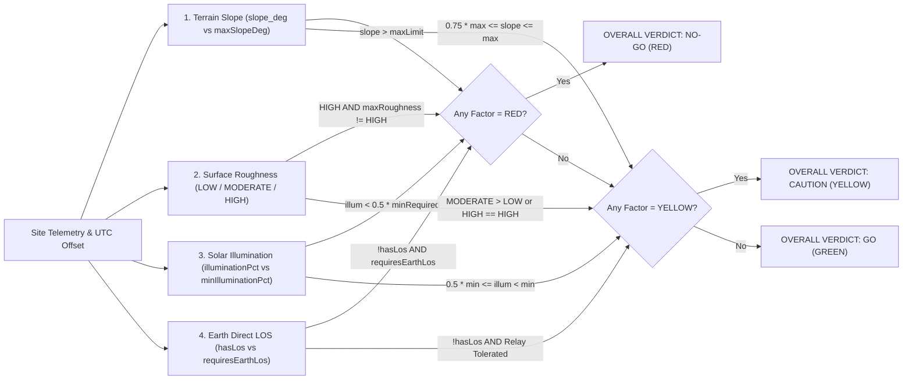
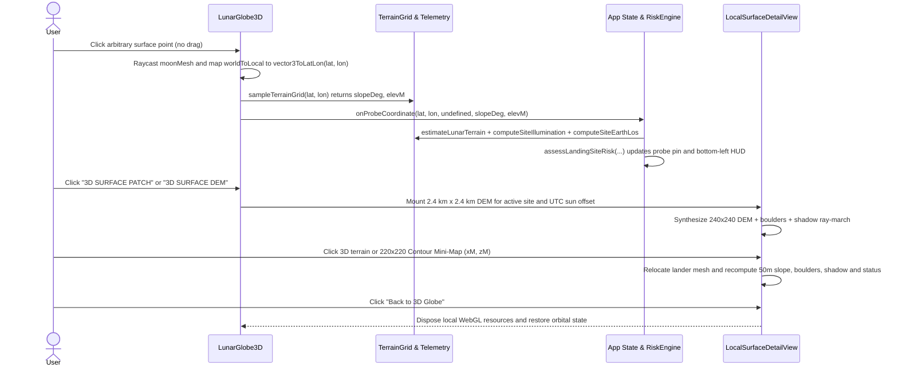

<div align="center">

# TO LAND OR NOT TO LAND

**Lunar Landing Site Navigator — Interactive Risk Assessment, 3D Surface Telemetry & Touchdown Hazard Decision Support**

*Built for NASA Space Apps Challenge 2026 — Open Science & Artemis Lunar South Pole Exploration*

[](./LICENSE)
[](https://to-land-or-not-to-land.vercel.app/)
[](https://www.spaceappschallenge.org/)
[](https://react.dev/)
[](https://www.typescriptlang.org/)
[](https://threejs.org/)
[](https://tailwindcss.com/)
[](./Dockerfile)

<br/>

<!-- Hero visual: swap for a 6-10 s GIF (e.g. docs/assets/hero.gif) once recorded -->


<sub>Whole-Moon WebGL view with the real-time Sun / Earth skybox, grid and SpaceX-style telemetry HUD.</sub>

<br/><br/>

<table>
  <tr>
    <td width="33%" align="center"><br/><sub><b>Whole-Moon 3D Globe</b> with Artemis candidate sites &amp; SpaceX-style HUD</sub></td>
    <td width="33%" align="center"><br/><sub><b>2.4 km Local Surface DEM</b> with ray-marched shadows &amp; boulders</sub></td>
    <td width="33%" align="center"><br/><sub><b>3-Site Comparison Matrix</b> across slope, roughness, sun &amp; Earth link</sub></td>
  </tr>
</table>

</div>

---

### 🌐 Live Interactive Mission Control
> **Experience the platform live in your browser:**  
> 🔗 **[https://to-land-or-not-to-land.vercel.app/](https://to-land-or-not-to-land.vercel.app/)**  
> *(Zero installation required — WebGL 3D lunar terrain, real NASA datasets, and real-time telemetry)*

---

## 🏆 NASA International Space Apps Challenge 2026

> **Challenge:** “To Land or Not to Land: Choosing the Best Lunar South Pole Touchdown Site”
>
> **Mission Goal:** Help Artemis mission planners evaluate safe landing zones near the lunar South Pole by reconciling extreme topographic hazards (steep crater slopes, boulder fields, permanently shadowed regions) with vital mission resources (near-continuous sunlight and direct Earth communications).

---

## 🚀 Key Features at a Glance

<table>
  <tr>
    <td width="50%" valign="top">
      <h3>🌕 Whole-Moon 3D WebGL</h3>
      4K LROC albedo, seam-free object-space normals down to the <code>-90°</code> pole, a north-up selenographic orbit camera, and a real-time 3D deep-space skybox (pinpoint stars, Milky Way, Earth and Sun).
    </td>
    <td width="50%" valign="top">
      <h3>🏔️ 2.4 km Surface DEM</h3>
      Meter-scale (<code>10 m/px</code>) finite-difference topography with ray-marched shadows, boulder scattering and an interactive 50 m touchdown pad.
    </td>
  </tr>
  <tr>
    <td width="50%" valign="top">
      <h3>🛰️ 4-Factor Flight Risk Engine</h3>
      Live Go / Caution / No-Go determination across terrain slope, surface roughness, solar illumination and direct-to-Earth line-of-sight, tunable with Strict / Artemis / Tolerant presets.
    </td>
    <td width="50%" valign="top">
      <h3>⏱️ Synodic Ephemeris Simulator</h3>
      A ±14-day scrubber around an editable Mission Epoch (UTC) that keeps Sun elevation, Earth libration and the terminator in sync across the globe, local horizon view and telemetry.
    </td>
  </tr>
  <tr>
    <td width="50%" valign="top">
      <h3>📍 9 NASA Artemis Candidate Regions</h3>
      The October 2024 shortlist is built in (toggle markers <code>ON</code>/<code>OFF</code>; hover <b>i</b> for provenance), and any custom coordinate can be probed on the Moon.
    </td>
    <td width="50%" valign="top">
      <h3>🆚 Side-by-Side Comparison &amp; Horizon View</h3>
      Compare up to 3 sites live, and see exactly where the Sun and Earth sit relative to the local horizon, including the 0°–5° grazing comms zone.
    </td>
  </tr>
</table>

---

## 🧮 The 4-Factor Risk Formula

Each factor is scored independently, and the **worst factor dominates** the overall verdict (`NO-GO` > `CAUTION` > `GO`). The limits below are the default **Artemis** profile and scale live with the selected lander profile / presets.

| Verdict | Terrain Slope | Solar Illumination | Surface Roughness | Earth Direct Line-of-Sight |
| :--- | :--- | :--- | :--- | :--- |
| 🟢 **GO** | `< 7.5°` | `≥ 60%` | Within tolerance (`LOW`) | Direct link available |
| 🟡 **CAUTION** | `7.5°` – `10°` | `30%` – `59%` | `MODERATE` above tolerance | Relay-tolerant mission without direct link |
| 🔴 **NO-GO** | `> 10°` (tip-over risk) | `< 30%` (deep shadow / PSR-like) | `HIGH` beyond tolerance | Blocked while direct link is required |

> The baseline thresholds in [`riskEngine.ts`](./client/src/engine/riskEngine.ts) (`slope 5° / 15°`, `illumination 70% / 30%`) apply when no lander profile is supplied. The UI additionally flags a **grazing Earth link (`0°` – `5°` elevation)** as a comms-margin warning tier. Full rationale: [`docs/risk_methodology.md`](./docs/risk_methodology.md).

---

## 🛠️ Tech Stack

| Layer | Technologies |
| :--- | :--- |
| **Frontend & 3D** | React 18, TypeScript 5.6, Three.js (WebGL), Tailwind CSS 3.4, Lucide Icons |
| **Data & Ephemeris** | NASA LRO LOLA, LRO LROC (ASU), modeled JPL Horizons-style Sun / Earth geometry, IAU Gazetteer, NASA Artemis candidate regions (Oct 2024) |
| **Deployment & Tooling** | Vite 5, Docker, Nginx, Vercel |

---

## 🔗 Submission Deliverables & Quick Links

| Deliverable | Link |
| :--- | :--- |
| **Live Interactive Mission Control** | [to-land-or-not-to-land.vercel.app](https://to-land-or-not-to-land.vercel.app/) |
| **Project Master Architecture** | [`ARCHITECTURE.md`](./ARCHITECTURE.md) |
| **Candidate Sites & Terrain Catalog** | [`docs/candidate_sites.md`](./docs/candidate_sites.md) |
| **NASA Data Sources & Documentation** | [`docs/data_sources.md`](./docs/data_sources.md) |
| **Risk Scoring Methodology** | [`docs/risk_methodology.md`](./docs/risk_methodology.md) |
| **Source Code** | [github.com/AdeshDeshmukh/to-land-or-not-to-land-](https://github.com/AdeshDeshmukh/to-land-or-not-to-land-) |
| **Space Apps Submission Profile** | _TODO: insert Space Apps project page link_ |

---

## Table of Contents

1. [Mission Context & Executive Summary](#1-mission-context--executive-summary)
2. [Core Platform Capabilities](#2-core-platform-capabilities)
3. [System Architecture, ER Model & Engineering Diagrams](#3-system-architecture-er-model--engineering-diagrams)
4. [Curated Landing Sites & Lander Profiles](#4-curated-landing-sites--lander-profiles)
5. [Repository & File Structure](#5-repository--file-structure)
6. [Scientific & Mathematical Foundations](#6-scientific--mathematical-foundations)
7. [Quick Start & Local Deployment](#7-quick-start--local-deployment)
8. [NASA Data Sources & Attribution](#8-nasa-data-sources--attribution)
9. [Engineering Quality Protocol, Team & License](#9-engineering-quality-protocol-team--license)

---

## 1. Mission Context & Executive Summary

Landing near the **Lunar South Pole (`-70°` to `-90°` latitude)** presents an extraordinary engineering paradox. Peaks of near-eternal light (such as **Shackleton Crater Rim** and **Malapert Massif Peak**) receive quasi-continuous solar illumination ideal for photovoltaic power, while sitting just kilometers away from **Permanently Shadowed Regions (PSRs)** harboring cryogenic water-ice volatiles.

Because solar elevation hovers only **`+1°` to `+4°`** above the polar horizon, minor topographic ridges cast kilometer-long dynamic shadows, steep crater walls threaten lander tip-over, boulder aprons create touchdown hazards, and low southern Earth libration angles can sever **Direct-to-Earth (DTE)** telemetry links.

**To Land or Not to Land** bridges high-level orbital reconnaissance and meter-scale touchdown verification in a SpaceX Dragon/Starship-inspired monochrome telemetry interface:

- **Whole-Moon 3D WebGL Globe** built with `THREE.ObjectSpaceNormalMap`, isotropic polar LROC blending, and spherical LOLA elevation gradients so `-90°` renders seamlessly with zero polar distortion or starburst artifacts.
- **2.4 km × 2.4 km Local 3D Surface DEM Inspector (`10 m/px`)** capable of zooming down to meter-scale boulders, crater bowls, regolith micro-relief, and interactive touchdown pad relocation.
- **Live 4-Factor Flight Risk Engine & Synodic Cycle Ephemeris Simulator** that dynamically recalculates `GO` / `CAUTION` / `NO-GO` verdicts, shadows, and Earth LOS across arbitrary Moon coordinates and UTC mission timestamps.
- **NASA Artemis candidate regions, 3D deep-space context & side-by-side comparison**: the 9 shortlisted regions, a real-time 3D starfield / Earth / Sun skybox, a local horizon sky view, and up to 3 sites compared live.

---

## 2. Core Platform Capabilities

| Capability | Module | Engineering Highlights |
| :--- | :--- | :--- |
| **Whole-Moon 3D Globe** | `LunarGlobe3D.tsx` | `256 × 256` tessellation, native **4K (`4096 × 2048`)** LROC monochrome albedo (`maxAniso`), **`2048 × 1024`** Gaussian-deblocked `THREE.ObjectSpaceNormalMap` (zero polar TBN seams), `absLat > 84°` isotropic 4-tap LROC cap smoothing, and 27 IAU South Pole craters + 45 procedural micro-craters (`-68°` to `-78°` Hermite feathering). |
| **North-Up Orbit Controls** | `LunarGlobe3D.tsx` | Moon Trek-style north-up selenographic (lat / lon) orbit camera with inertial damping, wheel zoom (`MIN_CAM_DIST = 4.10`, `MAX_CAM_DIST = 22.0`), smooth fly-to for site selection, one-click **`South Pole`** (exact `90°S`) and **`Earth-Side`** presets, and zero-React-rerender 60 FPS imperative DOM pin/leader-line projection. |
| **3D Deep-Space Skybox** | `celestialSkybox3D.ts`, `LunarGlobe3D.tsx` | Native-pixel pinpoint `THREE.Points` starfield (`10,500` deep-field + `3,200` mid-field + `380` bright stars in spectral tints), a Milky Way sky sphere, a procedural 3D Earth (clouds, earthshine, city lights, Fresnel limb) and a 3D Sun with corona, all positioned from the live Sun / Earth ephemeris vectors. |
| **NASA Artemis Candidate Sites** | `LunarGlobe3D.tsx`, `candidateSites.ts` | The 9 regions from NASA's October 28, 2024 shortlist, a marker **`ON` / `OFF`** toggle, and a hover **`i`** provenance popover linking to NASA and the LPI South Pole Atlas. |
| **Sun / Earth Vectors & Grid** | `LunarGlobe3D.tsx` | Toggleable 3D Sun / Earth direction arrows with live sub-point labels and a toggleable selenographic grid (on by default); **Ambient Light** is off by default so the real day / night terminator stays high-contrast. |
| **Dynamic RYG Overlay HUD** | `LunarGlobe3D.tsx` | Smooth `1024 × 512` translucent sphere layer driven by mission constraints and UTC ephemeris; toggleable **`Landing Assessment Overlay: ON / OFF`** and live **`Overlay Opacity (0–100%, default 42%)`** slider over unobstructed monochrome terrain. |
| **Click-to-Inspect & Custom Coords** | `LunarGlobe3D.tsx`, `App.tsx` | Single-click any location on the Moon to sample the LOLA grid, deploy a target probe pin, and inspect live `GO`/`CAUTION`/`NO-GO` telemetry in `[data-testid="surface-risk-hud"]`; or deploy exact targets via the `COORDS` popover. |
| **2.4 km 3D Local Surface DEM** | `LocalSurfaceDetailView.tsx` | Coordinate-seeded `240 × 240` (`10 m/px`) local lunar DEM patch with 3D `InstancedMesh` boulder clusters, ray-marched crater self-shadowing, **`Regolith` / `RYG Hazard` / `Topo Contours`** modes, **`Mesh`** wireframe, camera presets (`Oblique`, `Low Grazing`, `Overhead`), and clickable 3D / `220 × 220` 2D Mini-Map touchdown pad relocation. |
| **4-Factor Risk Engine** | `riskEngine.ts` | Evaluates **Terrain Slope**, **Surface Roughness**, **Solar Illumination**, and **Earth LOS (DTE)** against customizable vehicle limits with deterministic worst-case dominance (`RED > YELLOW > GREEN`). |
| **Synodic Cycle & UTC Simulator** | `lunarTelemetry.ts`, `App.tsx` | Scrub `±14 days` around an editable **Mission Epoch (UTC)** across the `29.530589`-day lunar synodic cycle (the slider's `Nominal` label follows the epoch) or step UTC (`-1D`, `-6H`, `T0`, `+6H`, `+1D`, custom date/time) while synchronizing 3D directional lighting, horizon masks, DTE libration, and `CountdownTimers`; **`Best Sun Window`** jumps to peak solar elevation. |
| **Local Horizon & Sky View** | `LocalHorizonSkyView.tsx` | Compact sky-dome widget in the Site Assessment drawer plotting the Sun and Earth at their computed azimuth / elevation relative to the `0°` horizon and the `0°`–`5°` grazing comms band. |
| **Side-by-Side Site Comparison** | `App.tsx` | Queue up to `3` sites (including custom coordinates) and compare verdict, slope, roughness, solar illumination, Earth LOS tier and operational windows live as the timeline or constraints change. |
| **Flight Telemetry & Dual Modes** | `HorizonPlot.tsx`, `MethodologyModal.tsx`, `Glossary.tsx` | Slide-out left (`Mission Inputs`) & right (`Site Assessment`) drawers, 2D Sun/Earth azimuth-elevation `HorizonPlot`, topographic `ElevationProfile`, `PlainEnglishSummary`, **`Planner` vs `Educator`** mode with plain-English callouts, and the Scoring Methodology popover. |

---

## 3. System Architecture, ER Model & Engineering Diagrams

### 3.1 System Architecture & Data Pipeline (`flowchart TD`)



---

### 3.2 Domain Entity-Relationship Diagram (`erDiagram`)



---

### 3.3 4-Factor Risk Assessment Decision Matrix (`flowchart LR`)



---

### 3.4 Click-to-Inspect & Local 3D Surface Workflow (`sequenceDiagram`)



---

## 4. Curated Landing Sites & Lander Profiles

### NASA Artemis Candidate Landing Regions ([`candidateSites.ts`](./client/src/data/candidateSites.ts))

The 9 regions below come from NASA's shortlist finalized on **October 28, 2024** ([NASA release](https://www.nasa.gov/news-release/nasa-identifies-candidate-regions-for-landing-next-americans-on-moon/), [LPI South Pole Atlas](https://www.lpi.usra.edu/lunar/lunar-south-pole-atlas/)). Coordinates and selection status follow NASA / LPI; elevation, slope, roughness and baseline illumination / Earth-link values are **approximate modeled estimates** for the demo risk engine, not official NASA site assessments. Full catalog: [`docs/candidate_sites.md`](./docs/candidate_sites.md).

| # | Site Name | Lat / Lon | Elevation | Slope | Roughness | Baseline Sun Flux | Earth DTE | Selection Status |
| :-: | :--- | :---: | :---: | :---: | :---: | :---: | :---: | :--- |
| 1 | **Peak near Cabeus B** | `-83.60°`, `-68.80°` | `+1,450 m` | `5.4°` | `LOW` | `82%` | Direct LOS | Added in 2024 |
| 2 | **Haworth** | `-87.45°`, `-5.17°` | `+1,920 m` | `8.6°` | `MODERATE` | `76%` | Direct LOS | Retained from 2022 |
| 3 | **Malapert Massif** | `-86.00°`, `+2.70°` | `+4,850 m` | `6.8°` | `MODERATE` | `86%` | Direct LOS | Retained from 2022 |
| 4 | **Mons Mouton** | `-84.60°`, `+31.00°` | `+5,100 m` | `4.1°` | `LOW` | `89%` | Direct LOS | Added in 2024 |
| 5 | **Mons Mouton Plateau** | `-84.30°`, `+30.60°` | `+4,720 m` | `3.4°` | `LOW` | `88%` | Direct LOS | Added in 2024 |
| 6 | **Nobile Rim 1** | `-85.30°`, `+31.50°` | `+2,680 m` | `9.2°` | `MODERATE` | `74%` | Direct LOS | Retained from 2022 |
| 7 | **Nobile Rim 2** | `-84.20°`, `+60.70°` | `+1,840 m` | `14.8°` | `HIGH` | `54%` | Occluded | Retained from 2022 |
| 8 | **de Gerlache Rim 2** | `-88.71°`, `-64.00°` | `+2,950 m` | `6.2°` | `MODERATE` | `84%` | Direct LOS | Retained from 2022 |
| 9 | **Slater Plain** | `-87.13°`, `+127.86°` | `-420 m` | `4.5°` | `LOW` | `68%` | Occluded | Added in 2024 |

### Reference Spacecraft Constraint Profiles ([`landerProfiles.ts`](./client/src/data/landerProfiles.ts))

| Vehicle Profile | Agency / Era | Max Slope | Min Solar Flux | Max Roughness | Direct Earth DTE | Payload / Crew |
| :--- | :--- | :---: | :---: | :---: | :---: | :---: |
| **Mission Default Parameters** | Artemis Criteria | `10.0°` | `60%` | `MODERATE` | Required | `15,000 kg` / `4 crew` |
| **SpaceX Starship HLS** | NASA Artemis III/IV | `8.0°` | `65%` | `MODERATE` | Required | `100,000 kg` / `4 crew` |
| **Blue Origin Blue Moon MK2** | NASA Artemis V | `10.0°` | `60%` | `MODERATE` | Required | `30,000 kg` / `4 crew` |
| **CLPS / VIPER Scout** | NASA / CLPS Robotic | `15.0°` | `35%` | `HIGH` | Optional (Relay) | `450 kg` / Uncrewed |
| **Apollo Lunar Module** | Historical (1969–1972) | `6.0°` | `75%` | `LOW` | Required | `4,700 kg` / `2 crew` |

---

## 5. Repository & File Structure

```text
to-land-or-not-to-land-/
├── .github/
│   └── PULL_REQUEST_TEMPLATE.md      # NASA dataset attribution & verification PR checklist
├── docs/
│   ├── assets/                       # README hero & feature screenshots (compressed JPEGs)
│   ├── CESIUMJS_3D_GLOBE_SPEC.md     # Architectural spec for global-to-polar 3D visualization
│   ├── LAURI_TASK_PLAN.md            # Science & visualization milestone plan
│   ├── candidate_sites.md            # Terrain dossier on Artemis candidate landing zones
│   ├── data_sources.md               # NASA LRO LOLA, LROC & JPL Horizons provenance
│   └── risk_methodology.md           # Scoring formulas and G/Y/R flight threshold rationale
├── scripts/
│   ├── build-lunar-textures.ps1      # Helper script to generate/optimize static texture maps
│   └── README.md                     # Asset pipeline notes
├── client/                           # React + TypeScript + Vite WebGL application
│   ├── public/
│   │   └── textures/
│   │       ├── lroc_color_2k.jpg         # NASA LROC global monochrome/albedo equirectangular map
│   │       ├── lroc_color_poles_4k.jpg   # High-res LROC polar mosaic for surface synthesis
│   │       ├── lola_bump_2k.jpg          # NASA LRO LOLA global elevation heightmap
│   │       └── lola_slope_overlay_2k.png # Reference LOLA gradient map
│   ├── src/
│   │   ├── components/
│   │   │   ├── LunarGlobe3D.tsx          # Main 3D WebGL Moon, skybox, Artemis markers, vectors & HUD
│   │   │   ├── LocalSurfaceDetailView.tsx# 2.4 km x 2.4 km 3D Local DEM, boulders & 2D contour map
│   │   │   ├── LocalHorizonSkyView.tsx   # Local horizon sky dome with Sun/Earth az-el & grazing band
│   │   │   ├── LandingParametersPanel.tsx# Mission constraints sliders, toggles & presets
│   │   │   ├── HorizonPlot.tsx           # 360 deg polar azimuth-elevation Sun/Earth sky plot
│   │   │   ├── ElevationProfile.tsx      # 1 km landing approach cross-section profile
│   │   │   ├── CountdownTimers.tsx       # Daylight remaining & DTE comms window countdowns
│   │   │   ├── ComparisonModal.tsx       # Multi-site side-by-side trade-study matrix
│   │   │   ├── MethodologyModal.tsx      # Green/Yellow/Red rubric & dataset documentation modal
│   │   │   ├── CustomProbeModal.tsx      # Coordinate targeting helper modal
│   │   │   ├── LanderSelector.tsx        # Spacecraft tolerance preset selector
│   │   │   ├── DataAttribution.tsx       # Dataset citation banner component
│   │   │   ├── PlainEnglishSummary.tsx   # Natural-language mission readiness briefing
│   │   │   ├── Glossary.tsx              # Planner vs Educator context & interactive tooltips
│   │   │   ├── Starfield.tsx             # Ambient procedural deep-space star backdrop
│   │   │   └── LunarGlobe.tsx            # Lightweight legacy 2D orbital preview helper
│   │   ├── data/
│   │   │   ├── candidateSites.ts         # 9 NASA Artemis candidate region definitions
│   │   │   └── landerProfiles.ts         # 4 aerospace vehicle constraint profiles
│   │   ├── engine/
│   │   │   └── riskEngine.ts             # 4-factor evaluation & overall G/Y/R assessment logic
│   │   ├── types/
│   │   │   └── index.ts                  # Strict TypeScript domain models & interfaces
│   │   ├── utils/
│   │   │   ├── celestialSkybox3D.ts      # Procedural 3D starfield, Milky Way, Earth & Sun space environment
│   │   │   └── lunarTelemetry.ts         # Selenographic math, 72 polar craters, Sun/Earth ephem
│   │   ├── App.tsx                       # Root telemetry state, drawers, time playback & modals
│   │   ├── index.css                     # Obsidian monochrome HUD palette & range slider styling
│   │   └── main.tsx                      # React 18 mount entry
│   ├── index.html                        # Full-viewport SPA shell
│   ├── package.json                      # Dependencies & Vite/TypeScript build scripts
│   ├── tailwind.config.js                # Tailwind utility configuration
│   ├── tsconfig.json                     # Strict TypeScript compiler configuration
│   └── vite.config.ts                    # Vite dev server (port 3000) & manual chunk splitting
├── AGENTS.md                         # Engineering pre-push build, visual & git protocol
├── ARCHITECTURE.md                   # High-level platform design reference
├── Dockerfile                        # Multi-stage Node 20 build -> Nginx 1.25 production image
├── docker-compose.yml                # One-command containerized deployment on port 3000
├── LICENSE                           # MIT Open Source License
├── nginx.conf                        # SPA Nginx static serving configuration
└── README.md                         # This documentation
```

---

## 6. Scientific & Mathematical Foundations

### 1. Seam-Free 3D Polar Mapping & Object-Space Normals
Standard equirectangular normal maps using `THREE.TangentSpaceNormalMap` suffer from diverging GPU screen-space UV derivatives (`dFdx(vUv)` / `dFdy(vUv)`) where sphere triangles converge at `lat = -90°`, causing radial starburst artifacts around Shackleton Crater. This project instead computes true **3D Object-Space surface normals**:

$$\vec{N}_{\text{obj}} = \text{normalize}\!\left(\vec{P} - \left(\frac{\partial H}{\partial E}\,\hat{E} + \frac{\partial H}{\partial N}\,\hat{N}\right)\right)$$

Combined with constant arc-step spherical sampling of LOLA elevation ($\Delta\theta = 0.0042\text{ rad}$) and 4-tap isotropic polar smoothing for $|\text{lat}| > 84^\circ$, topography remains mathematically continuous across all `360°` at the poles.

### 2. Synodic Solar Ephemeris & Earth Optical Libration
Referenced to **`2026-09-01 00:00 UTC`** with lunar synodic period $T_{\text{syn}} = 29.530589\text{ days}$:

- **Subsolar Point**: $\text{lat}_\odot \in [-1.45^\circ, +1.45^\circ]$ (southern lunar summer near $T_0$), regressing westward at $360^\circ / T_{\text{syn}}$ per day.
- **Effective Solar Elevation**: $\theta_{\text{eff}} = \arcsin(\vec{P}\cdot\hat{S}) - \theta_{\text{horizon\_cutoff}}(\text{lat}, \text{lon})$, shifting lighting dynamically across polar rims and deep floors.
- **Earth Optical Libration (DTE)**: Models periodic latitudinal ($\sim 27.32\text{ d}$) and longitudinal ($\sim 27.55\text{ d}$) libration plus local horizon blocking in `computeEarthTelemetryAtTime`.

### 3. Meter-Scale Local Terrain & Shadow Ray-Marching
Inside `LocalSurfaceDetailView.tsx`, clicking **`3D SURFACE PATCH`** samples a $2.4\text{ km} \times 2.4\text{ km}$ finite-difference grid ($240 \times 240$ vertices, $\Delta s \approx 10.04\text{ m}$), computes vertex slopes $\arctan(\sqrt{(\partial_x H)^2 + (\partial_z H)^2})$, places ejecta boulders sized by roughness tier, and ray-marches $24$ horizon steps along local East-North-Up (ENU) solar vectors to flag self-shadowed touchdown pockets in real time.

---

## 7. Quick Start & Local Deployment

### Option A — Docker Compose (Recommended)

Run the production Nginx build in a single command without installing local Node toolchains:

```bash
# 1. Clone the repository
git clone https://github.com/AdeshDeshmukh/to-land-or-not-to-land-.git
cd to-land-or-not-to-land-

# 2. Build and launch on port 3000
docker compose up --build

# 3. Open in your browser
# http://localhost:3000
```

Stop and clean up the container with:

```bash
docker compose down
```

### Option B — Local Node.js Development

**Prerequisites:** Node.js `>= 20.0.0` and npm `>= 10.0.0`

```bash
# 1. Install client dependencies
cd client
npm install

# 2. Start Vite HMR development server (http://localhost:3000)
npm run dev

# 3. Type-check and compile optimized production bundle
npm run build

# 4. Preview production bundle locally
npm run preview
```

> **Windows / Network-Drive Note:** When developing inside cloud-synced drives (such as Google Drive Stream), running `npm run dev` or `npm run build` from a local NTFS directory mirror avoids file-watcher locking issues.

---

## 8. NASA Data Sources & Attribution

| Dataset / Service | Provider | Role in Platform | Documentation |
| :--- | :--- | :--- | :--- |
| **LRO LOLA DEM (`lola_bump_2k.jpg`)** | NASA GSFC / LOLA Science Team | Global elevation relief, spherical gradient slope computation, and local terrain baseline | [`docs/data_sources.md`](./docs/data_sources.md) |
| **LRO LROC WAC & Poles Mosaic** | NASA / ASU LROC | Photorealistic grayscale lunar albedo and isotropic polar cap detail (`4k`) | [`docs/data_sources.md`](./docs/data_sources.md) |
| **JPL Horizons Geometry Model** | NASA JPL | Subsolar progression & Earth optical libration ephemeris alignment | [`lunarTelemetry.ts`](./client/src/utils/lunarTelemetry.ts) |
| **IAU Gazetteer / Artemis Site Catalog** | IAU / NASA Artemis Planning | Benchmark South Pole craters (27 named basins) & the 9 Artemis candidate landing regions | [`docs/candidate_sites.md`](./docs/candidate_sites.md) |
| **NASA Artemis Candidate Landing Regions (Oct 28, 2024)** | NASA | Names, coordinates and selection status of the 9 candidate regions | [NASA release](https://www.nasa.gov/news-release/nasa-identifies-candidate-regions-for-landing-next-americans-on-moon/) |
| **LPI Lunar South Pole Atlas** | Lunar and Planetary Institute (USRA) | Reference topographic and illumination maps for the candidate regions | [LPI Atlas](https://www.lpi.usra.edu/lunar/lunar-south-pole-atlas/) |

---

## 9. Engineering Quality Protocol, Team & License

Every contribution in this repository adheres to the verification workflow defined in [`AGENTS.md`](./AGENTS.md):
- Zero TypeScript errors and zero bundling warnings (`cd client && npm run build`).
- Live headless/interactive WebGL visual inspection with `0` console errors across full-screen desktop viewports.
- Strict security & repository hygiene (no tracked secrets, `.env` files, or unoptimized raw binary dumps).

### Contributors

- **Adesh Deshmukh** — Tech Lead & Full-Stack Architect ([@AdeshDeshmukh](https://github.com/AdeshDeshmukh))
- **Lauri Salonen** — Product, Telemetry & 3D Visualization Lead ([@salonelauri](https://github.com/salonelauri))
- **Rishika** — Data & UI Design
- **Ethan** — 3D & Visualization

### License

Distributed under the **Apache License 2.0** — see [`LICENSE`](./LICENSE) for full terms. Built for the NASA Space Apps Challenge 2026.
